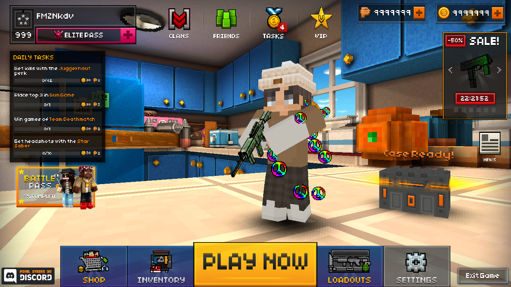

This is the Pixel Strike server emulator, last version, written in Zig.

# Requirements

- [Zig (0.17.0)](https://ziglang.org/download/)
- Linux
- Brain..? 🧑🏿‍🦯

# Server

## Building

```bash
git clone https://github.com/fmznkdv/ReversalPS
cd ReversalPS
```

## Running

```bash
zig run Master.zig -O ReleaseSmall
```

The server will start listening on `0.0.0.0:3000` by default.

# Client

Download [client from steam](https://store.steampowered.com/app/915320/Pixel_Strike_3D/) and Download patched client & lib, then run in bash:
```bash
STEAM_COMPAT_DATA_PATH="/home/fmznk/.local/share/Steam/steamapps/compatdata/915320" STEAM_COMPAT_CLIENT_INSTALL_PATH="/home/fmznk/.local/share/Steam" SteamAppId=915320 SteamGameId=915320 LD_PRELOAD="fmznkdv.so" timeout 300 "/home/fmznk/.local/share/Steam/steamapps/common/Proton - Experimental/proton" run "/home/fmznk/.local/share/Steam/steamapps/common/Pixel Strike 3D/PixelStrike3D.exe"
```
